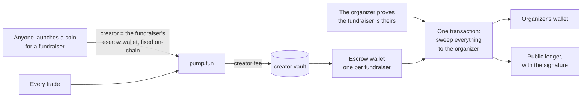

<p align="center"></p>
<h1 align="center">Ape for Good</h1>
<p align="center"><b>Any public GoFundMe fundraiser can have a coin. The fee from every trade goes to that fundraiser, and nobody else can touch it.</b></p>
<p align="center">
  <a href="https://github.com/Bruhmare/ape-for-good/actions/workflows/test.yml"></a>
  
  
  
</p>
<p align="center">
  <a href="https://charity-ruddy-mu.vercel.app">Website</a> ·
  <a href="https://charity-api-production-d1b7.up.railway.app/api/coins">Live coins</a> ·
  <a href="https://charity-api-production-d1b7.up.railway.app/api/ledger">Public ledger</a> ·
  <a href="docs/money-flow.md">The money path, step by step</a> ·
  <a href="SECURITY.md">Trust model</a>
</p>

This is the backend of Ape for Good: every rule about where the money goes lives here, and it is public so you can
read the rules instead of taking our word for them. The website is a static front-end and is not in this repository.

## Where the money goes



1. **Launch.** Anyone can launch a fundraiser's coin. [`prepareOpenLaunch`](api/src/launch.js#L173-L190) builds
   pump.fun's `create_v2` with the launcher's wallet paying and the fundraiser's **escrow wallet as the coin's
   creator**. pump.fun stores the creator on the bonding curve; after that nobody can change it.
2. **Trade.** pump.fun pays the creator fee of every trade, on the curve and after graduation, into a vault only
   that creator can collect. Nothing in this repository sits in that path.
3. **Escrow.** The wallet is [`Keypair.fromSeed(HMAC-SHA256(ESCROW_SEED, "charity-escrow:" + slug))`](api/src/escrow.js#L16-L18):
   derived the moment it is needed, never written anywhere, one per fundraiser.
4. **Claim.** The organizer puts a one-time code in their own fundraiser story. [`codeIsInPage`](api/src/gfm.js#L127-L132)
   looks in the story and title only, never in donor comments, and [`verifiedClaim`](api/src/launch.js#L68-L82)
   hands them a signed, one-hour token. [`prepareClaim`](api/src/escrow.js#L30-L46) then builds **the only
   transaction this code ever signs with an escrow key**: collect the vault, transfer the whole balance to the
   organizer. Their wallet co-signs and pays the network fee.
5. **Ledger.** The sweep is written down before it is sent and published with its signature once it lands:
   [`GET /api/ledger`](https://charity-api-production-d1b7.up.railway.app/api/ledger).

## Check it without trusting us

| what we say | how you check it |
|---|---|
| the coin's creator is the fundraiser's escrow wallet | `GET /api/coins/:mint` gives `escrow.address`; the bonding curve on-chain names the same creator. `node tools/verify.mjs <mint>` reads both and compares. |
| nothing ever leaves an escrow wallet except published payouts | the wallet's history on Solscan is public; `verify.mjs` lists every transfer out and matches each one to a ledger row. |
| only the organizer can claim | [`verifiedClaim`](api/src/launch.js#L68-L82) and [`codeIsInPage`](api/src/gfm.js#L127-L132); the test `claim tokens` in [`api/test/money.test.js`](api/test/money.test.js) tries every tamper. |
| nothing but that sweep signs with an escrow key | `grep -rn escrowKeypair api/src`; the test `the escrow key is private to escrow.js` fails if another code path touches it. |
| every payout is real | each ledger signature opens on Solscan; `verify.mjs --all` reads each transaction and checks the organizer's wallet received the amount. |

```sh
cd api && npm ci
node tools/verify.mjs --all                        # every live coin and every payout, checked against mainnet
node tools/verify.mjs <mint or slug>               # one coin
node tools/verify.mjs --mint <any pump.fun mint>   # who a pump.fun coin pays, straight from the curve
```

It uses Solana's public RPC and the public API. Nothing is signed, nothing needs a key.

## What the operator cannot do

- **Spend escrow.** The key exists only inside [`prepareClaim`](api/src/escrow.js#L30-L46), the sweep to the verified
  organizer. There is no withdraw route, no admin transfer, no second place that signs with it.
- **Take a cut.** A launch pays pump.fun's create cost and the network fee; a claim pays the network fee. Nothing is
  deducted from a payout and there is no operator fee anywhere in the flow.
- **Redirect the fees.** The creator is written on the bonding curve by pump.fun at launch. The chain enforces that,
  not this server.
- **Hide a payout.** A sweep is recorded before it is broadcast and published once it confirms.
- **Verify on someone's behalf.** The proof is a code in the fundraiser's own story, which only the organizer can edit.
- **Move money with the admin page.** [`admin.js`](api/src/admin.js) is read-only: it reports, it cannot transfer.

What you *are* trusting is spelled out in [SECURITY.md](SECURITY.md): mainly that the public API runs this code, and
custody of the seed. Both are the kind of thing the on-chain record would expose the moment they went wrong.

## The money-path API

| | |
|---|---|
| `POST /api/launch/open/prepare` `{wallet, slug, name, symbol, description, imageDataUrl}` | anyone; the escrow wallet is the creator |
| `POST /api/launch/prepare` `{wallet, claim, name, symbol, description}` | the verified organizer; their wallet is the creator |
| `POST /api/launch/submit` `{mint, signedTransaction}` | broadcast; the coin is live when the cluster confirms |
| `POST /api/verify/start` `{url, wallet}` → `POST /api/verify/check` `{slug, wallet}` | the ownership code and the claim token |
| `POST /api/escrow/prepare` `{wallet, claim}` → `POST /api/escrow/submit` `{id, signedTransaction}` | the sweep |
| `GET /api/coins` · `GET /api/coins/:mint` · `GET /api/fundraisers/:slug` | every coin with its escrow address and figures |
| `GET /api/ledger` | every payout: fundraiser, wallet, lamports, signature, time |

Every `prepare` simulates the transaction first, so one the chain would refuse costs nothing and says why in
words; every `submit` refuses a signed transaction whose message is not byte-for-byte the one it prepared.

## Run and test

```sh
cd api && npm ci
node src/server.js                                     # API on :4270
DATA_DIR=./data-test npm test                          # unit tests, no network
DATA_DIR=./data-sim node test/sim.mjs                  # mainnet simulation of a launch and a claim; no SOL spent
```

Node 24. Configuration is environment only ([`api/.env.example`](api/.env.example)); nothing secret is in this
repository. Deployment notes are in [`DEPLOY.md`](DEPLOY.md).

## Also in here

The rest of the API is the plumbing around the money path: the fundraiser directory read from GoFundMe's public
sitemaps and pages ([`directory.js`](api/src/directory.js), [`gfm.js`](api/src/gfm.js)), comments
([`comments.js`](api/src/comments.js)) and the read-only admin overview ([`admin.js`](api/src/admin.js)). The
server reads public pages only; it never signs in to GoFundMe or posts there.

## License

[MIT](LICENSE).
