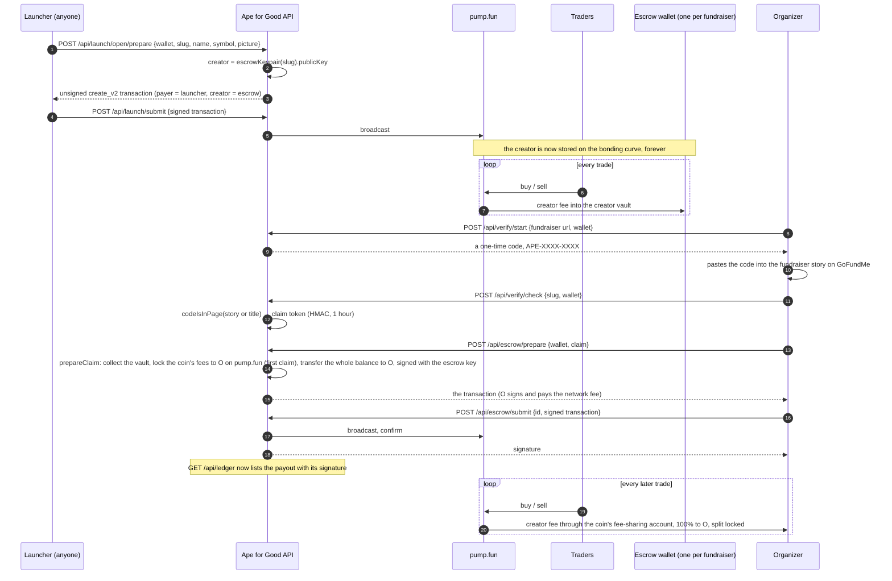

# The money path, step by step

Every number below is a lamport amount on Solana mainnet; every step points at the code that does it.



## 1. A coin is launched with the escrow wallet as its creator

[`api/src/launch.js`](../api/src/launch.js) → `prepareOpenLaunch` → `buildLaunch`. The create instruction comes from
pump.fun's own SDK ([`api/src/pump.js`](../api/src/pump.js), `createInstruction`) with:

- `user` = the launcher's wallet. They pay pump.fun's create cost and the network fee. There is no dev buy.
- `creator` = `escrow.escrowKeypair(slug).publicKey`. pump.fun pays this address the creator fee of every trade.
- `creatorFeeBps` = `CREATOR_FEE_BPS` (300 by default), clamped to what pump.fun allows at that moment.

The transaction is simulated first; if the chain would refuse it nothing is sent. The server pre-signs with the
mint keypair (a throwaway that proves nothing about money), the launcher's wallet signs the rest. The coin's
record is written before the broadcast so that a crash cannot lose a live coin.

A fundraiser's organizer can instead verify first and launch from their own wallet (`prepareLaunch`); then they
are the creator and pump.fun pays them directly, with no escrow in between.

## 2. Fees accrue in the creator vault

pump.fun keeps a creator vault per creator address. On every trade on the curve, and after graduation on the
pool, it moves the creator fee there. Nothing in this repository is in that path; it is pump.fun's program.
`escrowStatus` ([`api/src/escrow.js`](../api/src/escrow.js)) reads what the vault owes plus what the wallet already
holds, and the fundraiser's page shows both.

## 3. The escrow wallet

```js
Keypair.fromSeed(crypto.createHmac('sha256', escrowSeed()).update(`charity-escrow:${slug}`).digest())
```

One secret (`ESCROW_SEED`) and the fundraiser's slug give the wallet. It is derived at the moment a transaction
is built and goes out of scope right after. No file, log, or route ever holds the key or even the address
(the address is recomputed when a page asks for it). The test `escrow wallets` in
[`api/test/money.test.js`](../api/test/money.test.js) checks the data files for it after a run.

## 4. Proving who the organizer is

The only person who can edit a fundraiser's story is its organizer, so a code placed there is the proof.

1. `POST /api/verify/start` issues `APE-XXXX-XXXX` (`gfm.newCode`, 8 characters from a 32-letter alphabet,
   no ambiguous glyphs) bound to the wallet that asked.
2. The organizer pastes it into the story or title and saves.
3. `POST /api/verify/check` re-reads the public page, fresh, and `codeIsInPage` looks for the code in the title
   and story only. Donor comments and updates are never searched, so nobody can verify by commenting.
4. On success the wallet gets a token: `slug.verifiedAt.HMAC-SHA256(CLAIM_SECRET, slug|wallet|verifiedAt)`.
   `verifiedClaim` checks it with a constant-time compare, against the stored claim, for that wallet, within
   `CLAIM_TTL_MINUTES` (60). The test `claim tokens` tries every tamper.

## 5. The claim

`prepareClaim(slug, owner)` in [`api/src/escrow.js`](../api/src/escrow.js) builds one transaction
(`claimInstructions`):

1. On the first claim, `SystemProgram.transfer(owner → escrow, 0.01 SOL)`: the organizer lends the escrow the rent
   for the fee-sharing account. Whatever the rent does not use comes back in step 5.
2. `collectCoinCreatorFeeInstructions(escrow, owner)`: pump.fun pays the vault out to the escrow wallet; the
   organizer is the fee payer.
3. On the first claim, `create_fee_sharing_config` (pump.fun's fee program, the escrow signs as the coin's
   creator): the coin gets a fee-sharing account, and pump.fun makes that account the coin's creator.
4. On the first claim, `update_fee_shares` with the organizer as the only shareholder at 10,000 bps. pump.fun pays
   anything pending to the old shareholder first, then sets `adminRevoked`: the split can never be updated again.
   After a claim, later claims instead send `distribute_creator_fees`, which pays what the coin has earned since
   straight to the organizer (anyone may send it).
5. `SystemProgram.transfer(escrow → owner, everything)`: the escrow's balance after steps 1 to 4, read from a
   simulation, so nothing is left behind.

It is simulated, the compute limit is pinned from the simulation, then it is signed with the escrow key and
handed to the organizer, who signs it as payer. A ledger row is written with status `pending` and the exact
message bytes **before** the transaction is returned. `submitClaim` refuses any signed transaction whose
message is not byte-for-byte the one it prepared, broadcasts, waits for confirmation, and only then marks the
row `done`. Once a coin is locked, a claim with nothing to collect is refused because it would cost more than it moves.

This was checked against mainnet state: built for a live pump.fun coin and simulated, the transaction ran all
eight instructions, emptied the escrow, and left a fee-sharing account naming the organizer at 100% with
`adminRevoked: true`; a second `update_fee_shares` in the same simulation failed with `SharingConfigAdminRevoked`.

## 6. The ledger

`GET /api/ledger` returns every row with status `done`: fundraiser slug, the organizer's wallet, lamports, the
Solana signature and the time. Pending rows are not shown. The fundraiser's page and the coin's page carry
the same rows. Anyone can open a signature on Solscan and see the transfer.

## Checking all of it from outside

```sh
cd api && npm ci
node tools/verify.mjs --all
```

For every live coin it reads the bonding curve and compares its creator with the escrow address the site
publishes, lists every transaction in which the escrow wallet lost lamports and matches each one to a ledger row,
and for every ledger row reads the transaction and confirms the organizer's wallet received the amount. It
uses Solana's public RPC and the public API only; nothing here needs a key.
